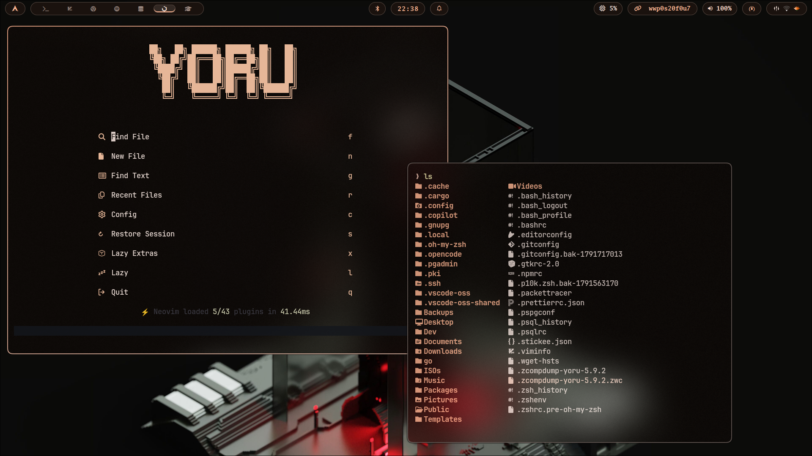
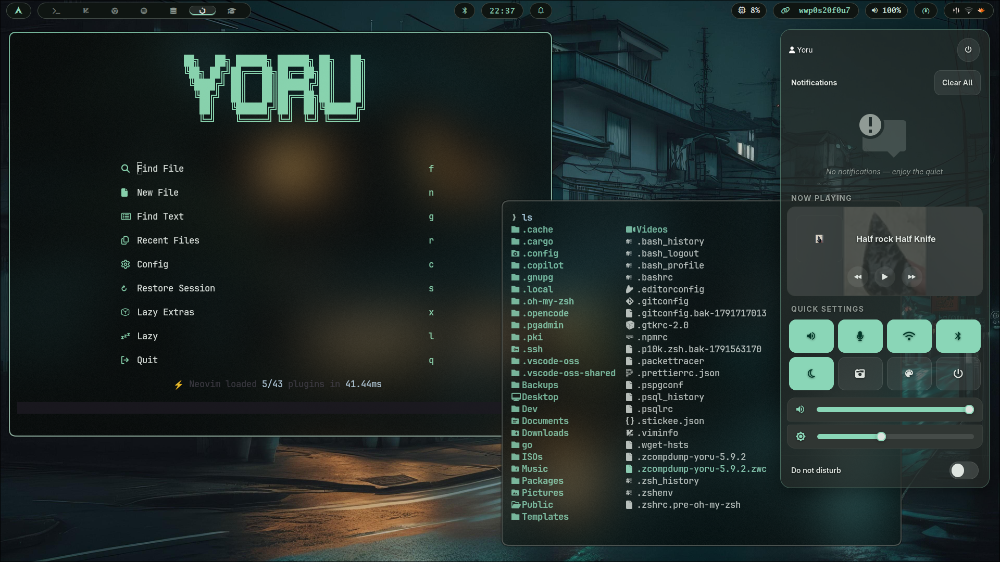

<div align="center">


<p><b>Turning code into tools that make life easier.</b> I build full-stack web experiences and maintain a warm-dark Linux universe — <b>HyprYoru 🌙</b> + <b>YoruNeovim</b> — where every app follows the wallpaper.</p>


</div>

---

## 🌙 About Me

<table>
<tr>
<td width="58%">

**🎓 CS student → Software Engineer in progress.** I care about fundamentals, algorithms, and shipping real tools — not just tutorials.

**🧑‍💻 What I do now:**

- Full-stack web — polished UI to backend logic
- Linux ricing as a craft — Arch + Hyprland + matugen dynamic theming
- Neovim distro maintainer — LazyVim-based, aesthetic-first
- Building in public, learning open-source

**🎯 Mission:** master the craft, ship impactful projects, build tech with lasting value.

**📍 Nairobi, KE (EAT) • Open to internships, collabs & open-source**

</td>
<td width="42%">

```yaml
# $ fastfetch — yoru
OS: Arch Linux x86_64
DE: Hyprland (HyprYoru 🌙)
Shell: zsh + p10k + fzf + eza
Editor: YoruNeovim (LazyVim)
Terminal: kitty + Tmux
Font: JetBrainsMono Nerd Font
Theme: Yoru #FFB692 on #1A120E
Palette: matugen → kitty/waybar/
    rofi/swaync/nvim sync
DB: PostgreSQL + psql + pgAdmin
```

</td>
</tr>
</table>

---

## 💻 Tech Stack

<div align="center">

### Languages

[](https://skillicons.dev)


### Editor & Shell


### Linux & Daily CLI — the Yoru aesthetic


</div>

---

## ⭐ Featured — the Yoru universe + web

<div align="center">

<table>
  <tr>
    <td width="50%"><a href="https://github.com/ae-orlando/HyprYoru"></a></td>
    <td width="50%"><a href="https://github.com/ae-orlando/YoruNeovim"></a></td>
  </tr>
  <tr>
    <td width="50%"><a href="https://github.com/ae-orlando/fedora-dev-setup-script"></a></td>
    <td width="50%"><a href="https://github.com/ae-orlando/bachiruCoffeeHouse"></a></td>
  </tr>
</table>

</div>

| Project                                                                             | What it is                                                                                                   | Tech                                                 |
| ----------------------------------------------------------------------------------- | ------------------------------------------------------------------------------------------------------------ | ---------------------------------------------------- |
| [🌙 HyprYoru](https://github.com/ae-orlando/HyprYoru)                               | Feature-rich Arch + Hyprland rice. Dynamic wallpaper theming, beautiful UI, terminal follows system.         | `Shell` `Hyprland` `matugen` `Waybar` `Rofi` `Kitty` |
| [🌙 YoruNeovim](https://github.com/ae-orlando/YoruNeovim)                           | Aesthetic Neovim distro on LazyVim. Matugen system colors + Catppuccin Mocha fallback, full lazy.nvim power. | `Lua` `Neovim` `lazy.nvim` `matugen`                 |
| [🛠️ fedora-dev-setup-script](https://github.com/ae-orlando/fedora-dev-setup-script) | Fresh Fedora → full dev env (kitty + zsh) + timestamped backup/rollback script.                              | `Bash` `Zsh` `Kitty` `Fedora`                        |
| [☕ bachiruCoffeeHouse](https://github.com/ae-orlando/bachiruCoffeeHouse)           | Coffee-shop landing page — warm, polished, responsive.                                                       | `HTML` `CSS` `JavaScript`                            |

> **How Yoru theming works:** `wallpaper → matugen → hypr + kitty + waybar + rofi + swaync + btop + nvim` in one `set-wall.sh` run. Change wallpaper, whole system repaints. That's the demo worth starring.

<details>
<summary><b>📸 Rice showcase — same setup, two wallpapers (click to expand)</b></summary>
<br/>
<div align="center">


<p><sub>Left: peach <code>#FFB692</code> • Right: mint — one <code>set-wall.sh</code> run repaints Hyprland, Kitty, Waybar, Rofi, SwayNC and Neovim</sub></p>
</div>
</details>

---

## 📊 GitHub Dashboard

<div align="center">


</div>

---

## 🐍 Contributions

<div align="center">


</div>

---

## 🧩 Currently Learning & Goals

**Now:** sharpening full-stack (JS → PostgreSQL), Shell scripting depth, CS fundamentals + algorithms, open-source workflow.

**Next:** TypeScript, testing, backend hardening, shipping Yoru to v1.0 + first external contributors.


<details>
<summary><b>💬 Dev quote + joke (click to expand)</b></summary>
<br/>
<div align="center">

<br/><br/>

</div>
</details>

---

## 🌐 Connect With Me

<div align="center">

[](mailto:elishaorlando756@gmail.com)
[](https://www.linkedin.com/in/elisha-orlando-a68bb0382)
[](https://instagram.com/small_cench)
[](https://www.youtube.com/@CmdOrlando)
[](https://wa.me/+254795637768)

<p>💬 <b>Always open to internships, freelance, collabs & conversations.</b><br/>Working on something interesting — Linux, web, or open-source? Reach out, I'd love to connect.</p>

</div>

---


<div align="center">

✨ <i>Code. Learn. Build. Repeat.</i> ✨ — <b>🌙 夜 Yoru</b>

</div>
